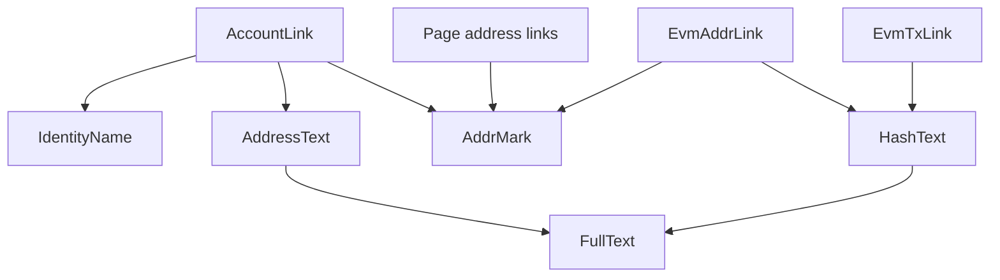

# Address components

- `AddrMark` is the only hover highlight. It owns the hover store and the box, and wraps a link with `asChild`.
- Page address links are the account and EVM address headers, the mapped substrate account, the EVM origin and the token contract.
- `EvmTxLink` points at a transaction, so it has no highlight.
- `AddressText` shows an SS58 address as 7…4 or in full, `HashText` does the same for 0x values as 0x4…4, and both wrap the full form through `FullText`.
